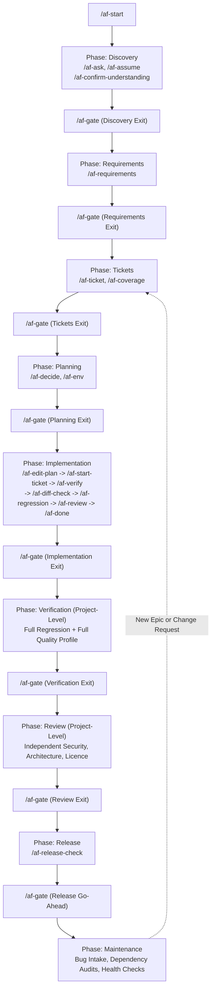

# Workflow Map — The Single Source of Truth

Policy file — changes require an approved `rule-change` (§S2.4).

This document is the **single source of truth** for all Agentflow commands, phase transitions, command guards, guidance routing, and cheat sheet generation. Every agent adapter, skill, check, and guidance engine derives its flow directly from this table.

---

## Command System Overview

### Core Commands (8)
The foundational commands for routine development. Every agent interface and cheat sheet highlights these:
1. `/af-start` — Initialize project and set up `.agentflow/`
2. `/af-next` — Primary guidance router; inspects state and recommends next command
3. `/af-ask` — Ask clarification questions during discovery or requirements
4. `/af-ticket` — Create and size user-story tickets with testable criteria
5. `/af-verify` — Verify implementation steps against criteria with evidence
6. `/af-done` — Complete and freeze a ticket after clean diff, regression, and review
7. `/af-status` — Show concise project status, edit lock, active ticket, and next action
8. `/af-help` — Contextual help on framework commands, rules, and usage

### Advanced Commands (46)
Specialized lifecycle, governance, safety, quality, and recovery commands reached via `/af-next` or invoked directly as needed.

---

## Execution Lifecycle & Command Guard (§S11.4)

Before executing ANY command, the agent must perform **Preflight Verification**:
1. Check that the current project phase matches the command's allowed phases.
2. Confirm all listed **Preconditions** are met.
3. Verify that the **Edit Lock** is respected: source edits are strictly forbidden unless an active claimed ticket has an approved Edit Manifest.
4. If preflight fails, **refuse execution**, state which precondition failed, and redirect to the command that resolves it.

After executing ANY command, the agent must perform **Postflight Verification**:
1. Verify that all listed **Postconditions** (records written, events logged, files modified) are fulfilled.
2. Ensure state changes are logged to `events/` and `STATE.md` is updated.
3. Conclude the response with the standard **Footer** (§S11.3):
   `Done: <produced> | Logged: <event ids> | Next: <command> because <reason> | Needs you: <questions/approvals or "nothing">`

---

## Master Workflow Map Table

The table below defines all 54 commands. No command may be added, altered, or removed without an approved rule change.

| Phase | Situation | Command | Preconditions | Skills Loaded | Actor | Postconditions | Next (success) | Next (failure) | Next (blocked) | Common Mistakes |
|---|---|---|---|---|---|---|---|---|---|---|
| none | No `.agentflow/` exists | `/af-start` | No active `project.md`; workspace writable | `using-agentflow`, `project-scaffolding` | agent + owner | Declares tier (0/1/2); copies init files; creates `project.md` with owner defaults; logs init event | `/af-ask` | `/af-doctor` | `/af-blockers` | Guessing defaults instead of asking owner; failing to declare tier; overwriting existing config |
| any | Determine next action | `/af-next` | `.agentflow/STATE.md` exists and readable | `using-agentflow` | agent | Reads `STATE.md`; looks up workflow map; outputs exact command + reason; updates `next_action` | Recommended command | `/af-stuck` | `/af-blockers` | Inventing commands not in map; auto-approving human steps; executing out-of-phase commands |
| any | Explain rule or decision | `/af-why` | `STATE.md` exists; recent event or next action available | `using-agentflow` | agent | Explains rationale citing workflow map row, gate criteria, or invariant; no state change | Return to `next_action` | `/af-help` | `/af-ask` | Hallucinating rules not in spec; giving vague ungrounded answers; editing files |
| any | Query help or command syntax | `/af-help` | `workflow-map.md` accessible | `using-agentflow` | agent | Outputs command syntax, preconditions, postconditions, and usage guidance; no state change | Return to `next_action` | `/af-why` | None | Explaining non-existent commands; displaying obsolete syntax |
| any | Inspect operational status | `/af-status` | `STATE.md` exists and readable | `using-agentflow` | agent | Outputs current phase, edit lock state, tier, active ticket/manifest, ticket counts, next action | Continue to `next_action` | `/af-rebuild` | `/af-blockers` | Reading every event file instead of `STATE.md`; modifying state during read-only status call |
| any | Progress or metrics report | `/af-report` | Ticket and event records readable | `using-agentflow`, `documentation` | agent | Produces human-readable summary of completed/blocked tickets, active waivers, risks, effort metrics | Return to active command | `/af-status` | `/af-blockers` | Dumping raw internal IDs without plain-language context; editing project records |
| any | Verify claims vs reality | `/af-audit` | Verification records exist in `verifications/` | `anti-hallucination-verification` | agent | Samples recent verification records; re-executes commands; compares output; logs audit findings | Continue active phase | `/af-incident` | `/af-ask` | Trusting historical pasted text without re-executing; silently ignoring failed audit runs |
| discovery, any | Missing information or ambiguity | `/af-ask` | Question identified; max 5 questions batched; blocking first | `requirements-elicitation`, `ambiguity-check` | agent + user | Creates `questions/Q-<id>.md` with category, blocking flag, recommended default; logs event | `/af-ask` or `/af-confirm-understanding` | `/af-ask` | `/af-blockers` | Asking >5 questions at once; asking open-ended questions without defaults; silent assumptions |
| discovery, requirements | Non-critical unknown with reasonable default | `/af-assume` | Question is non-blocking; default stated with rationale | `requirements-elicitation` | agent + user | Creates `questions/Q-<id>.md` marked `assumed`; requires explicit user confirmation before counting | `/af-ask` | `/af-ask` | `/af-blockers` | Assuming blocking items; treating unconfirmed assumption as verified fact; silent assumption |
| discovery | All blocking questions resolved | `/af-confirm-understanding` | Zero open blocking questions; all assumptions confirmed | `requirements-elicitation`, `ambiguity-check` | agent + owner | Summarizes goals, personas, scope, tech stack, constraints, NFRs; owner confirms; logs event | `/af-gate` | `/af-ask` | `/af-blockers` | Advancing without explicit owner confirmation message; glossing over unresolved ambiguities |
| requirements | Discovery confirmed | `/af-requirements` | Discovery gate passed; understanding confirmed | `requirements-elicitation`, `user-story-writing` | agent + owner | Creates `requirements/REQ-<id>.md` with MoSCoW, source Q, status `baselined`; derives `requirements.md` | `/af-gate` | `/af-requirements` | `/af-ask` | Missing MoSCoW priorities; omitting traceability to source answers; writing untestable requirements |
| tickets | Tickets drafted | `/af-coverage` | Scope baseline approved; tickets drafted | `ticket-breakdown` | agent | Verifies every REQ maps to ≥1 ticket and every ticket maps to REQ; generates `traceability.md` | `/af-gate` | `/af-ticket` | `/af-ask` | Advancing to planning with unmapped requirements; ignoring orphan tickets without justification |
| tickets, any | Feature, bug, or task definition | `/af-ticket` | Requirements baseline exists (or bug/change intake) | `user-story-writing`, `ticket-breakdown` | agent | Creates `tickets/T-<id>.md` with Given/When/Then criteria, verification methods, size, test plan | `/af-coverage` or `/af-edit-plan` | `/af-ticket` | `/af-blockers` | Vague acceptance criteria; omitting verification method per criterion; sizing L without splitting |
| planning, implementation | Planning done; avoid context pollution | `/af-build` | Discovery/requirements/tickets ready; `unverified_step: none` | `clean-context-build-loop`, `session-handoff-resume` | agent + owner | Generates `.agentflow/BUILD-BRIEF.md` (<1k tokens) & `.agentflow/BUILD-PROMPT.txt`; outputs fresh-session loop command | Open new session & run loop prompt | `/af-rebuild` | `/af-blockers` | Coding 6 tickets inside noisy discovery chat; bulk-reading old Q&A/events |
| any | User inputs mid-session chat | `/af-intake` | User message received | `intake`, `ambiguity-check` | agent | Classifies message: answer, new info, requirement change, trivial lane, discussion; no code edits | Per classification | `/af-ask` | `/af-blockers` | Immediately editing code in response to user chat; treating casual remarks as baseline changes |
| implementation | Active ticket claimed | `/af-edit-plan` | Ticket claimed; edit lock ON; simplicity + UI craft checked | `change-control`, `lean-architecture`, `frontend-and-ui-craft`, `scope-guard` | agent + approver (or SA1) | Generates `manifests/T-<id>.md` (modify, create, forbidden, budget); verify-before-edit checklist; overlap check | `/af-start-ticket` | `/af-edit-plan` | `/af-approvals` | Listing broad globs instead of exact paths; omitting styles/test files from vertical slice; ignoring overlap |
| implementation | Edit Manifest approved | `/af-start-ticket` | Manifest approved (`approvals/A-*.md` or SA1); no unverified step | `change-control`, `git-workflow` | agent | Captures `baselines/T-<id>.md`; transitions ticket to `in-progress`; unlocks edit lock in `STATE.md` | Build slice (`rapid`/`balanced`) or 1-file step (`strict`), then `/af-verify` | `/af-sync` | `/af-approvals` | Starting with dirty working tree; editing before baseline is recorded; editing off manifest |
| implementation | Need file or dependency off manifest | `/af-expand-scope` | Ticket `in-progress`; unlisted file/dep discovered | `scope-guard`, `change-control` | agent + approver | Halts edits; records expansion request (file, why, criterion, alternative); requests approval | Continue ticket edits | Revert or split ticket | `/af-approvals` | Editing unlisted files before expansion approval; smuggling drive-by cleanups into expansion |
| implementation | Slice or step edit made | `/af-verify` | Edit made within manifest budget; unverified step/slice active | `anti-hallucination-verification`, `tdd-implementation`, `frontend-and-ui-craft` | agent | Runs tests, build/lint, + live runtime/UI smoke check; saves raw output in `evidence/`; writes `verifications/V-<id>.md`; clears step | Next slice or `/af-diff-check` | Fix within step or `/af-revert-unverified` | `/af-ask` | Claiming tests pass without running live app/runtime smoke check; mocking broken behavior; loosening assertions |
| implementation | Step verification failed or aborted | `/af-revert-unverified` | Unverified edits exist; step verification failed or 3 retries | `change-control`, `debugging` | agent | Restores unverified files of current step to baseline; clears unverified_step in `STATE.md`; logs event | Alternative step or `/af-stuck` | `/af-sync` | `/af-ask` | Leaving dirty unverified edits in tree; reverting files from earlier verified steps; not logging revert |
| implementation | All ticket steps verified | `/af-diff-check` | All criteria verified; no unverified step open | `change-control`, `code-review-self-check` | agent | Diffs tree against baseline; checks modified files match manifest and hygiene passes | `/af-regression` | Revert unmapped hunks | `/af-ask` | Allowing drive-by cleanups or formatting changes; ignoring unmapped hunks; modifying lockfile unnecessarily |
| implementation, verification | Diff check clean | `/af-regression` | `/af-diff-check` passed | `testing-strategy`, `anti-hallucination-verification` | agent | Executes full regression + build + runtime smoke check; records result and evidence; logs pass event | `/af-review` | `/af-ticket` (bug) or revert | `/af-ask` | Running only local tests instead of full regression + build; ignoring console/runtime errors |
| implementation, review | Regression passed | `/af-review` | `/af-regression` passed; diff checked; verifications complete | `code-review-self-check`, `independent-review`, `security-review` | reviewer (solo: structured self-review in `rapid`/`balanced`; independent in `strict`) | Inspects criteria, diff, UI/UX quality, edge cases; re-runs checks; writes `reviews/R-<id>.md` | `/af-done` | Fix findings via slice cycle | `/af-approvals` | Skipping edge-case/UI quality check; trusting pasted output without re-running checks; ignoring findings |
| implementation | Review passed with no blocking findings | `/af-done` | All criteria verified; runtime smoke green; diff clean; review passed | `change-control`, `using-agentflow` | agent | Freezes ticket files in protected registry; ticket status `done`; edit lock `locked`; updates `STATE.md` | `/af-next` or `/af-accept` | `/af-reopen` | `/af-blockers` | Marking done without runtime verification; leaving edit lock unlocked; forgetting to freeze code |
| implementation, release | Epic tickets completed | `/af-accept` | All tickets in epic `done`; epic integration check passes | `release-readiness`, `retrospective` | agent + owner | Presents demo script to owner; records owner response verbatim in `approvals/A-*.md`; logs acceptance | `/af-retro` | `/af-ticket` (bug/change) | `/af-approvals` | Assuming owner acceptance without explicit statement; faking user demo acceptance; skipping integration check |
| implementation, release | Epic accepted | `/af-retro` | `/af-accept` completed | `retrospective` | agent + user | Captures what went well, mistakes, improvements; creates `lessons/L-<id>.md`; updates `lessons.md` | `/af-next` or `/af-gate` | `/af-lesson` | None | Skipping retrospective under schedule pressure; recording generic platitudes instead of actionable lessons |
| planning, any | Architectural or technical decision | `/af-decide` | Options identified; simplicity gate evaluated | `lean-architecture`, `api-and-data-design` | agent + owner (one-way) | Creates immutable ADR `decisions/D-<id>-<slug>.md` (context, options, type, consequences); owner countersigns | Continue workflow | `/af-decide` | `/af-approvals` | Classifying one-way decision as two-way; proceeding with irreversible change without owner countersign |
| planning, any | Environment fact discovered | `/af-env` | Tool run or system inspected with evidence | `tech-stack-selection`, `anti-hallucination-verification` | agent | Creates `environment/<fact>.md` with evidence; updates derived `environment.md`; logs event | Continue workflow | `/af-ask` | `/af-blockers` | Guessing tool versions or commands without running check; recording unverified environment assumptions |
| discovery, requirements, any | Domain term defined | `/af-glossary` | Term identified; definition formulated | `requirements-elicitation` | agent + user | Creates `glossary/<term>.md`; updates derived `glossary.md`; logs glossary-added event | Continue workflow | Refine definition | `/af-ask` | Using conflicting domain terms without glossary entry; agent inventing jargon without user confirmation |
| any | Mistake made or insight discovered | `/af-lesson` | Failure analyzed or insight validated | `retrospective`, `error-handling-and-logging` | agent | Creates `lessons/L-<id>.md` (date, ticket link, mistake/insight, remedy); updates `STATE.md`; logs event | Resume workflow | None | None | Writing vague lessons ("be more careful"); repeating previously recorded mistakes; omitting ticket reference |
| any | State transition occurred | `/af-log` | Event type, actor, role, summary, ticket ID provided | `error-handling-and-logging` | agent | Writes `events/<UTC>-<ticket>-<type>-<id>.md`; triggers incremental `STATE.md` update | Next scheduled command | `/af-doctor` | None | Logging routine file reads/edits instead of state transitions; editing past event files; omitting compact UTC |
| any | Requirement change requested | `/af-change` | Change request received; impact analyzed | `change-request`, `ticket-breakdown` | agent + owner | Logs change request; updates `requirements/REQ-*.md` status; assesses ticket impact; owner approves | `/af-ticket` | Maintain baseline | `/af-approvals` | Modifying code without changing requirements and tickets; dropping requirements without a decision record |
| any | Policy file or adapter change | `/af-rule-change` | Proposed change to policy file or adapter rules | `rule-change` | agent + owner (countersign) | Creates rule-change proposal (what, why, weakens/strengthens); owner approves + countersigns; updates file | Continue with new rule | Retain existing policy | `/af-approvals` | Self-approving policy edits; weakening rules without countersign; modifying policy files directly |
| any | Adjust project strictness | `/af-strictness` | Valid strictness level (`light`, `balanced`, `strict`) | `rule-change` | owner | Submits rule change for `strictness` in `project.md`; logs event; updates gate/manifest verification depth | Continue in new mode | Retain current strictness | `/af-approvals` | Agent lowering strictness to bypass failed tests or strict reviews; changing strictness without countersign |
| any | Change ticket lane | `/af-lane-change` | Active ticket exists; justification provided | `change-control`, `rule-change` | agent + owner | Logs lane-change proposal; owner approves; updates ticket lane and required done-definition | Continue ticket | Retain original lane | `/af-approvals` | Moving to weaker lane without approval; downgrading Standard to Trivial after lines exceeded; silent lane swaps |
| any | Reopen done ticket | `/af-reopen` | Ticket status is `done`; linked `bug` or `change` ticket exists | `change-control`, `debugging` | agent + approver | Logs ticket-reopened event; unfreezes ONLY manifest files of the fix; transitions ticket to `in-progress` | `/af-edit-plan` | Ticket remains `done` | `/af-ticket` | Reopening without a linked bug or change ticket; unfreezing unrelated codebase files; editing without manifest |
| implementation, any | File or directory move/rename | `/af-rename` | Approved manifest lists rename; verify-before-edit passed | `change-control`, `refactoring` | agent | Executes rename; logs `rename` event (old/new paths, timestamp, rev); updates derived indexes | `/af-verify` | Revert rename | `/af-approvals` | Renaming files without an approved manifest; leaving dangling references in records; drive-by renames |
| implementation, any | 3 consecutive failed attempts | `/af-stuck` | 3 failed attempts recorded in events/transcripts | `debugging` | agent | Halts retries; creates `blockers/B-<id>.md`; documents hypotheses and failure reasons; prompts user | New hypothesis or `/af-ask` | `/af-blockers` | `/af-ask` | Silently continuing loops past 3 retries; changing random lines hoping tests pass; failing to log stuck blocker |
| any | Production break, secret leak, data loss | `/af-incident` | Incident criteria met; immediate action needed | `incident-response`, `secrets-and-redaction` | agent + approver | Enforces reproduce-first rule; minimal fix manifest approved; creates mandatory follow-up ticket; logs event | Verify fix, run follow-up | Escalate to owner | `/af-ask` | Skipping reproduction evidence; skipping follow-up ticket; leaking secrets into incident log record |
| any | External or human dependency blocks progress | `/af-blockers` | Blocker identified; owner and needed-by known | `using-agentflow` | agent | Creates `blockers/B-<id>.md`; updates `STATE.md`; marks dependent tickets `blocked`; routes to unblocked | `/af-next` (unblocked work) | Pause if all blocked | Wait for human | Halting all work when unblocked tickets exist; failing to assign blocker owner; untracked verbal blockers |
| any | User waives non-safety rule | `/af-waive` | Rule is waivable (never safety/secrets/policy/countersign) | `rule-change` | owner | Creates `waivers/W-<id>.md` (rule, reason, user's verbatim words, role, expiry); logs waiver event | Continue past waived rule | Enforce rule | `/af-approvals` | Waiving policy protections or secrets rules; agent generating self-waivers; indefinite unexpired waivers |
| any | Add protected path pattern | `/af-protect` | Valid path pattern; reason provided | `change-control` | owner | Appends path pattern, reason, approval requirement to `protected.md`; logs path-protected event | Continue workflow | None | None | Removing protected path without rule-change approval; forgetting to protect custom config files |
| any | Promote fact confidence label | `/af-label` | Evidence reference available for `verified` label | `anti-hallucination-verification` | agent | Updates confidence label in record; attaches evidence ref; logs fact-labelled event | Use verified fact | Remain `inferred` | `/af-ask` | Promoting inferred facts without evidence; using inferred facts to justify code edits |
| planning, tickets, implementation | Unknown requiring investigation | `/af-spike` | Spike objective defined; timebox set; isolation confirmed | `lean-architecture`, `anti-hallucination-verification` | agent | Isolates code to `spikes/` or branch (never merged); produces written conclusion record; logs event | `/af-ticket` | Re-evaluate architecture | `/af-ask` | Merging spike code into production codebase; running spikes without timebox or written conclusion |
| any | Batch pending human approvals | `/af-approvals` | Pending approval items exist | `using-agentflow` | agent + approver/owner | Compiles `APPROVALS-NEEDED.md`; batches items with risk and recommendation; logs approvals on receipt | Continue unblocked work | Address rejections | Wait for user review | Asking for approvals piecemeal instead of batched; missing risk categorization on approval requests |
| any | Working tree changed outside framework | `/af-sync` | Repo state diverges from `built_from` revision | `change-control`, `session-handoff-resume` | agent | Detects external file changes; logs `external-change` event; re-reads files; reports frozen files; rebuilds codemap | `/af-next` | `/af-reconcile` | `/af-ask` | Overwriting external changes without logging; ignoring modified frozen files |
| any | User or agent pauses session | `/af-pause` | Current step finished or unverified step reverted | `session-handoff-resume` | agent | Reverts unverified steps; writes `handoff/<date>.md`; updates `STATE.md`; logs session-paused event | Session safely paused | `/af-revert-unverified` | None | Leaving unverified dirty steps in workspace; omitting handoff notes; pausing mid-edit without logging |
| phase boundaries | Exit criteria met for current phase | `/af-gate` | All exit criteria in `gates.md` satisfied; verifications exist | `using-agentflow`, `release-readiness` | agent + owner | Validates all exit criteria; compiles gate checklist; owner explicitly approves; updates phase; logs event | First command of next phase | Fix failing exit criteria | `/af-approvals` | Advancing phase without owner approval; advancing with unconfirmed assumptions or orphan requirements |
| release | Must tickets accepted; release ready | `/af-release-check` | Phase is `release`; all Must tickets accepted | `release-readiness` | agent | Verifies quality profile, rollback note, release note, changelog, zero blockers; writes release report | `/af-gate` | Resolve release issues | `/af-blockers` | Releasing without documented rollback procedure; skipping full quality profile; unaccepted Must tickets |
| any | Transfer context to fresh agent/session | `/af-handoff` | Workspace in clean state; `STATE.md` current | `session-handoff-resume`, `delegation` | agent | Writes structured `handoff/<date>.md` with active ticket, completed work, blockers, unknowns, next command | Ready for `/af-resume` | `/af-pause` | None | Writing overly long handoffs (>1,500 tokens); leaving out exact `next_action` command; omitting open unknowns |
| any | Session starting or resuming | `/af-resume` | `.agentflow/` exists; agent active | `session-handoff-resume`, `using-agentflow` | agent | Re-reads `STATE.md` invariants; checks `built_from` vs git; runs `/af-sync` if needed; logs resume event | `next_action` from `STATE.md` | `/af-rebuild` | `/af-blockers` | Skipping `STATE.md` invariants; forgetting to check git diff from last session; resuming without re-grounding |
| planning, implementation | Cancel or rollback approved plan | `/af-undo-plan` | Manifest or plan exists; no permanent code changes made | `change-control` | agent + approver | Writes correction event superseding earlier manifest/plan (never deletes); resets ticket to `ready`; resets lock | `/af-edit-plan` | `/af-doctor` | `/af-approvals` | Hand-deleting past manifest files; violating immutability of records |
| any | Inconsistency between log, records, and disk | `/af-reconcile` | Divergence observed or duplicate records found | `using-agentflow` | agent | Compares event history with disk records; logs correction events for duplicates; updates derived views | `/af-status` | `/af-doctor` | `/af-ask` | Silently dropping records during reconciliation; modifying historical events |
| any | Derived views missing, corrupt, or merged | `/af-rebuild` | Immutable records and event files intact | `using-agentflow` | agent | Deterministically regenerates `STATE.md`, `requirements.md`, `traceability.md`, `codemap.md`, `CHEATSHEET.md` | `/af-status` | `/af-doctor` | None | Hand-editing derived files after merge conflicts; rebuilding from stale in-memory state |
| any | Health check and diagnostics | `/af-doctor` | Any workspace state | `using-agentflow` | agent | Diagnoses: missing files, wrong `project_id`, stale state, orphan tickets, unapproved edits, dangling references | Return to workflow | Run suggested fix command | `/af-ask` | Reporting errors without executable fix commands; altering project state during diagnostics |

---

## Phase Routing Flowchart

---

## Cross-Cutting Operations

These commands can be triggered across multiple phases when specific situations occur:

| Situation | Trigger Command | Subsequent Flow |
|---|---|---|
| User enters free-form text or unprompted requirement | `/af-intake` | Classify message -> route to `/af-ask`, `/af-change`, or answer |
| Requirement baseline needs modification | `/af-change` | Assess impact on tickets -> owner approval -> update tickets |
| Process rule or policy file needs alteration | `/af-rule-change` | Proposal -> owner approval + countersign -> update policy |
| Strictness level adjustment | `/af-strictness` | `/af-rule-change` flow for strictness property in `project.md` |
| Ticket needs to shift lanes | `/af-lane-change` | Proposal with justification -> owner approval -> update ticket |
| Done ticket regresses or needs fix | `/af-reopen` | Link bug ticket -> unfreeze manifest files -> `/af-edit-plan` |
| File or directory relocation | `/af-rename` | Manifest approval -> execute rename -> log rename event |
| 3 consecutive failures encountered | `/af-stuck` | Halt retries -> log blocker -> switch hypothesis or `/af-ask` |
| Production failure, leak, or data corruption | `/af-incident` | Reproduce first -> minimal fix manifest -> follow-up ticket |
| External input or approval missing | `/af-blockers` | Record blocker -> mark tickets blocked -> route to unblocked |
| Process rule bypass requested | `/af-waive` | Non-safety only -> owner justification -> record waiver with expiry |
| Additional file protection required | `/af-protect` | Append pattern to `protected.md` -> owner approval |
| Inferred fact ready for promotion | `/af-label` | Attach evidence reference -> promote to verified |
| High uncertainty exploration | `/af-spike` | Timebox in `spikes/` -> written conclusion -> new ticket |
| Multiple approvals waiting | `/af-approvals` | Batch in `APPROVALS-NEEDED.md` -> present with recommendations |
| Working tree altered externally | `/af-sync` | Compare `built_from` -> log external-change -> refresh state |
| Session interruption or handoff | `/af-pause` | Revert unverified step -> write `handoff/<date>.md` -> save state |
| Resuming after pause or compaction | `/af-resume` | Read invariants -> sync state -> output `next_action` |
| Rollback unexecuted plan | `/af-undo-plan` | Write correction event -> reset ticket -> reset edit lock |
| Log/filesystem discrepancy | `/af-reconcile` | Detect mismatch -> log correction event -> update views |
| Corrupt or merged derived views | `/af-rebuild` | Re-read primary records -> regenerate `STATE.md` and indexes |
| Framework integrity check | `/af-doctor` | Scan for 8 diagnostic conditions -> output exact fix commands |
